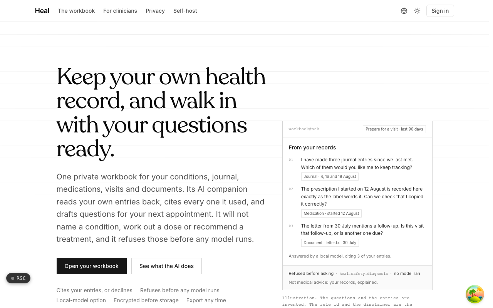
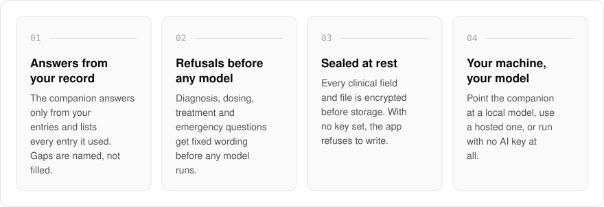
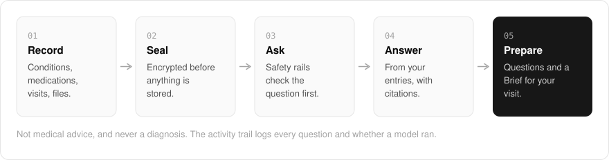

  <picture>
    <source media="(prefers-color-scheme: dark)" srcset=".github/assets/hero-dark.png">
    
  </picture>

<h1 align="center">heal.me.at</h1>

<strong>Keep your own health record, and walk in with your questions ready.</strong>

  
  
  
  

  <a href="#features">Features</a> ·
  <a href="#how-it-works">How it works</a> ·
  <a href="#built-with">Built with</a>

A health history ends up scattered across portals, paper and memory, and the appointment is over before you remember the question you meant to ask. I built heal.me.at as a personal illness workbook: your conditions, symptoms, medications, visits and documents in one place, with an AI companion that reads your own records back to you, cites every entry it used, and drafts questions for your next appointment. It will not name a condition, work out a dose or recommend a treatment, and it refuses those questions before any model runs. It is self-hostable, with a local-model option so your records never leave your machine.

> **Not medical advice, and never a diagnosis.** This is an early build that has not been reviewed by a clinician or a regulator.

  <picture>
    <source media="(prefers-color-scheme: dark)" srcset=".github/assets/overview-dark.svg">
    
  </picture>

## Why heal.me.at

| The usual health app | heal.me.at |
| --- | --- |
| An AI that will guess at a diagnosis | Diagnosis, dosing and treatment questions are refused before any model runs |
| Answers you cannot trace | Every answer lists the entries it was drawn from |
| Your records on someone else's server | Self-host it with a local model, or run with no AI key at all |
| Scores, streaks and symptom charts | Nothing is scored, ranked or charted |
| Hard to leave | A lossless archive plus a FHIR-shaped bundle, restorable on any instance |

## Features

- **Ask your own record**: answers come only from your entries and list the entries they were drawn from. When the record does not support an answer, the companion says what is missing.
- **Questions for your next visit**: a prepare-visit mode drafts questions for your clinician, each tied to the entry that prompted it.
- **Refusals before any model**: questions about diagnosis, dosing, treatment choice or emergencies get fixed wording instead of an answer, and an activity trail logs every question and whether a model ran.
- **Local, hosted or no model**: point the companion at a model on your own machine, use a hosted one, or run with no AI key at all.
- **One searchable timeline**: conditions, allergies, journal entries, medications, visits and documents in one view, filterable by kind. Nothing is scored, ranked or charted.
- **Sealed documents and records**: every clinical field and uploaded file is encrypted before storage, and with no key configured the app refuses to write rather than storing plain text.
- **A printable Brief and calendar export**: a one-page summary to hand over at an appointment (no model involved), plus medication times and visits as a calendar file.
- **Households and care access**: keep separate records for a parent, child or partner, and let a clinician read one record through a one-time code you issue and can withdraw.
- **Export and restore**: one export produces a lossless archive and a FHIR-shaped bundle, and the archive restores into any record on any instance.

## How it works

  <picture>
    <source media="(prefers-color-scheme: dark)" srcset=".github/assets/flow-dark.svg">
    
  </picture>

You record conditions, medications, visits and documents, and every clinical field and file is encrypted before it is stored. When you ask a question, the safety rails check it first: a refused question gets fixed wording and no model runs. Anything else is answered from your own entries, with citations, and the same record feeds the visit questions and the printable Brief.

## Built with

  
  
  
  
  
  

- Next.js 16 (App Router), React 19, TypeScript
- Tailwind CSS 4
- Drizzle ORM + Postgres
- Better Auth (email and password, plus OAuth)
- oRPC + TanStack Query
- AES-256-GCM envelope encryption for records and documents
- S3-compatible object storage (Cloudflare R2) for sealed documents
- Pluggable AI driver: a local model, Anthropic, or an offline stand-in

## Part of the me.at family

heal.me.at is one of my [`*.me.at`](https://me.at) apps. They share one design system, account, and app shell. Development happens in a private monorepo; this repository is the project's public-facing home.

## License

Source-available. See [LICENSE](LICENSE).
